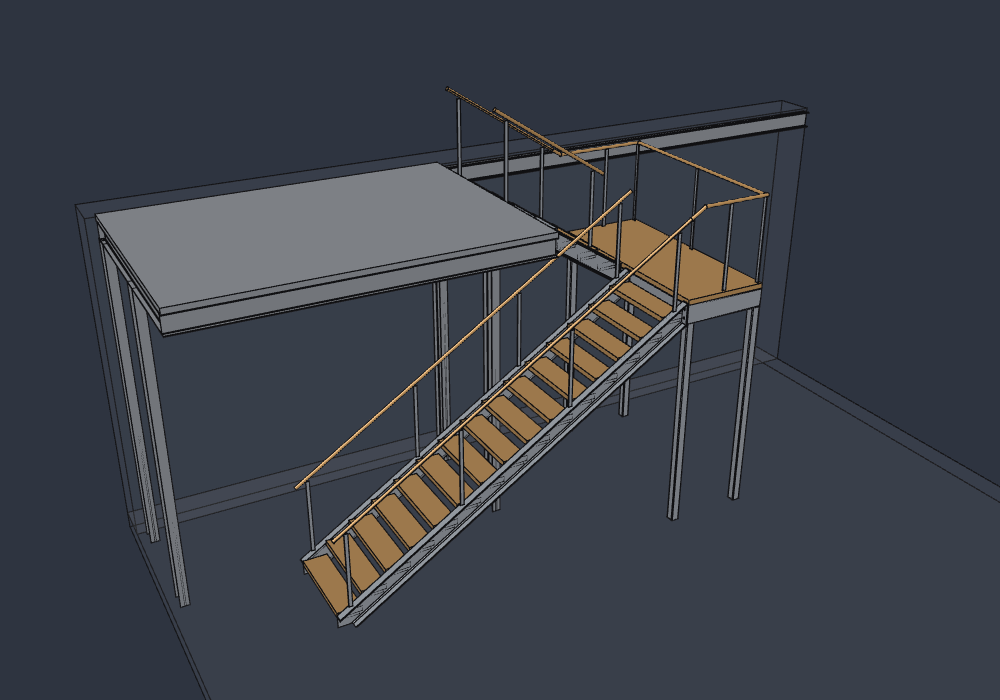

# Projet Escalier avec SolidCraft et Claude

Escalier à demi-tour en acier et chêne, modélisé de façon paramétrique dans **SolidCraft** et vérifié par un calcul de structure en Python.

*Parametric half-turn steel and oak staircase, modelled in SolidCraft, with a Python structural check (PyNite, Eurocodes).*

**[Voir en 3D →](cad/escalier.stl)** (vue interactive GitHub, à faire tourner à la souris)

## L'escalier

| | |
|---|---|
| Hauteur à monter | 3 800 mm, 22 contremarches de 172,73 mm |
| Giron, angle, Blondel | 274 mm, 32,23°, 619 mm |
| Volées | 17 + 5 contremarches, emmarchement 1 000 mm, jour 270 mm |
| Palier | 1 000 mm sur 4 pieds en tube 100×100×5 |
| Ossature | limons et cadre du palier en UPE 220, platines boulonnées M12 |
| Marches et plancher | chêne sur cornières 30×30×3 |

## Calcul de structure

Résultat principal du [rapport de calcul](calc/rapport/RAPPORT.md) : l'acier est largement dimensionné (taux ≤ 12 %), mais **les marches en chêne doivent faire au moins 38 mm** (30 mm dans le modèle actuel). Ce sont des ordres de grandeur : ils ne remplacent pas une note de calcul validée par un bureau d'études.

| Script | Rôle | Lancer |
|---|---|---|
| [`calc/predim.py`](calc/predim.py) | Prédimensionnement manuel | `python3 calc/predim.py` |
| [`calc/portique.py`](calc/portique.py) | Modèle en barres PyNite : stabilité, torsion, efforts aux appuis | `pip install PyNiteFEA` puis `python3 calc/portique.py` |
| [`calc/visu.py`](calc/visu.py) | Vue 3D PyVista des moments et de la déformée | `pip install pyvista` puis `python3 calc/visu.py` (ou `--png DOSSIER`) |

## Modifier l'escalier

Ouvrir [`cad/escalier.solidcraft`](cad/escalier.solidcraft) dans SolidCraft et changer les paramètres pilotes (`hauteur_totale`, `nb_contremarches`, `nb_volee1`, `giron`, `emmarchement`, `jeu_limons`, `palier_profondeur`…) : le squelette, les marches et leur nombre se recalculent. L'architecture du modèle et toutes les décisions de conception sont dans [CONCEPTION.md](CONCEPTION.md).

## Contenu

| Chemin | Contenu |
|---|---|
| `cad/escalier.solidcraft` | Modèle maître paramétrique |
| `cad/escalier.stl` | Export STL du modèle (vue 3D) |
| `calc/` | Scripts de calcul et [rapport](calc/rapport/RAPPORT.md) |
| `archive/` | Modèle FreeCAD d'origine et anciennes versions SolidCraft |
| `CONCEPTION.md` | Paramètres, décisions et historique de conception |

Conçu avec l'aide de [Claude Code](https://claude.com/claude-code).
