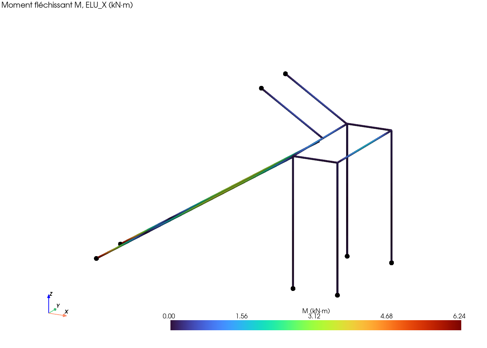
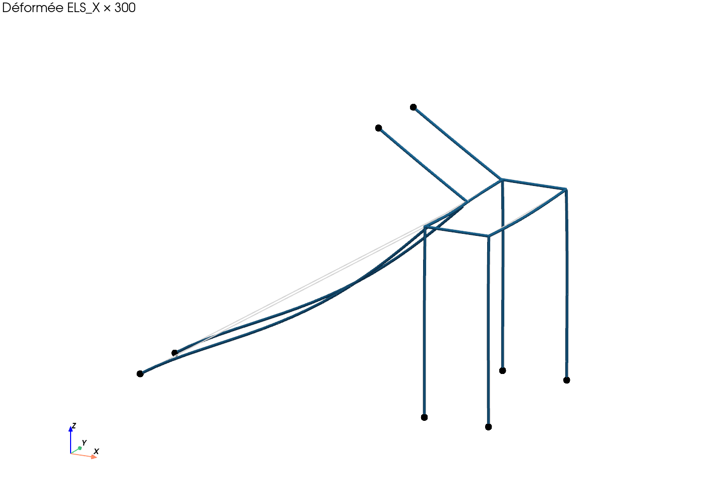

# Rapport de calcul — Escalier gab

27 octobre 2026 · version éditable : [doc Claude](https://claude.ai/artifact/S7D154tdD82mPPB65nKBjT)

La structure acier est largement dimensionnée (taux ≤ 12 %), mais les marches en chêne de 30 mm ne passent pas : il faut au moins 38 mm. Le palier est stable sans contreventement, à condition que l'arrivée en haut de la volée 2 reprenne environ 5,7 kN horizontaux par limon. Ce rapport donne des ordres de grandeur ; il ne remplace pas une note de calcul validée par un bureau d'études.

## 1. Description

Escalier droit à demi-tour, en acier et chêne, sans mur porteur : deux volées reliées par un palier sur quatre pieds. Valeurs du modèle `cad/escalier.solidcraft`, répartition 17/5.

| Élément | Valeur |
| --- | --- |
| Hauteur à monter | 3 800 mm, 22 contremarches de 172,73 mm |
| Giron, angle, Blondel | 274 mm, 32,23°, 619 mm |
| Répartition | 17 contremarches en volée 1, 5 en volée 2 |
| Emmarchement, jour | 1 000 mm, 270 mm |
| Palier | 1 000 mm de profondeur, plancher chêne 30 mm |
| Marches | chêne 30 mm sur 2 cornières 30×30×3 |
| Limons et cadre du palier | UPE 220 (26,6 kg/m) |
| Pieds du palier | tube 100×100×5, hauteur 2 686 mm |
| Liaisons | platines de 15 mm, 2 boulons M12 par platine |
| Portées des limons (inclinées) | volée 1 : 5 182 mm ; volée 2 : 1 619 mm |

## 2. Hypothèses

Charges de l'Eurocode 1 pour un escalier de logement (catégorie A, annexe nationale française). La nuance d'acier et la classe des boulons ne sont pas encore fixées : les valeurs ci-dessous sont supposées.

| Sujet | Hypothèse |
| --- | --- |
| Charge d'exploitation | q = 2,5 kN/m², ou Q = 2 kN ponctuelle (vérifications locales, non cumulées) |
| Poids propres | chêne 7,5 kN/m³, acier 78,5 kN/m³ |
| Chêne | D30 : fm,k = 30 MPa, E = 11 000 MPa ; kmod = 0,8, γM = 1,3 → fm,d = 18,5 MPa |
| Acier (supposé) | S235 : fy = 235 MPa, E = 210 000 MPa, γM0 = γM1 = 1,0 |
| Boulons (supposés) | classe 8.8, γM2 = 1,25 |
| UPE 220 | A = 33,9 cm², Iy = 2 680 cm⁴, Wy = 244 cm³ (catalogue) ; Iz = 244 cm⁴, J = 11,6 cm⁴ (calculés sans congés) |
| Combinaisons | ELU : 1,35 G + 1,5 Q ; ELS : G + Q (sans fluage) |
| Forces horizontales | défauts de verticalité seuls (EN 1993-1-1 §5.3.2, φ ≈ 1/253) ; pas de garde-corps pour l'instant |
| Critères | flèche L/300 ; déplacement horizontal du palier H/300 |

## 3. Méthode

Deux calculs complémentaires, écrits en Python et rangés dans le dépôt, lisent les mêmes paramètres.

1. **Calcul manuel** (`calc/predim.py`) : chaque pièce est une poutre sur deux appuis. Marches de portée 1 000 mm, limons inclinés chargés par mètre horizontal (une demi-volée par limon), poutre avant chargée par les 4 réactions de limons et le demi-palier, flambement des pieds avec une longueur de 2 H, cisaillement des boulons.
2. **Modèle en barres 3D** (`calc/portique.py`, PyNite) : pieds, cadre du palier et limons assemblés. Appuis :
    - pieds et pieds de limons V1 **encastrés** (platines chevillées dans une dalle béton) ;
    - haut des limons V2 **articulé** (boulonné à la structure supérieure) ;
    - limons **articulés** sur la poutre avant, avec l'excentricité de 29 mm entre l'âme et le centre de cisaillement de l'UPE ;
    - marches ignorées comme liaison entre limons (côté sécurité).

Contrôles : chaque script vérifie ses formules de base au lancement, et la somme des réactions du modèle égale les charges (43,5 kN à l'ELU).

## 4. Vérifications

Seules les marches ne passent pas : la flèche sous 2 kN atteint 188 % de l'admissible. Tout le reste travaille à 12 % au plus. Tableau trié par taux décroissant.

| Élément | Critère | Valeur | Limite | Taux | Résultat | Calcul |
| --- | --- | --- | --- | --- | --- | --- |
| Marche chêne 30 mm | flèche ELS | 6,26 mm | 3,33 mm | 188 % | **NON** | manuel |
| Marche chêne 30 mm | contrainte ELU | 18,50 MPa | 18,46 MPa | 100 % | **NON** | manuel |
| Limon V1 | flèche ELS | 2,01 mm | 17,27 mm | 12 % | OK | manuel |
| Poutre avant | flexion ELU (sur 2 appuis) | 24,9 MPa | 235 MPa | 11 % | OK | manuel |
| Limons V1 | flexion ELU (pied encastré) | 25,6 MPa | 235 MPa | 11 % | OK | modèle |
| Limon V1 | contrainte ELU (sur 2 appuis) | 24,3 MPa | 235 MPa | 10 % | OK | manuel |
| Poutre avant | torsion ELU (Saint-Venant) | 11,6 MPa | 135,7 MPa | 9 % | OK | modèle |
| Pied 100×5 | flambement ELU (2 H) | 11,9 kN | 144,4 kN | 8 % | OK | manuel |
| Boulons M12 platine V1 | cisaillement ELU | 2,70 kN | 32,4 kN | 8 % | OK | manuel |
| Poutre avant | flexion fort + faible ELU | 15,9 MPa | 235 MPa | 7 % | OK | modèle |
| Poutre avant | flèche ELS | 0,41 mm | 8,13 mm | 5 % | OK | manuel |
| Palier | déplacement horizontal ELS | 0,12 mm | 9,32 mm | 1 % | OK | modèle |
| Pieds 100×5 | N + M ELU | 0,01 | 1,00 | 1 % | OK | modèle |
| Limon V2 | contrainte ELU | 2,4 MPa | 235 MPa | 1 % | OK | manuel |
| Limon V2 | flèche ELS | 0,02 mm | 5,40 mm | 0 % | OK | manuel |

**Épaisseur minimale des marches en chêne D30 sur 1 000 mm : 38 mm**, soit 40 mm en pratique. Le plancher du palier, en 30 mm sur 1 000 mm, n'est pas vérifié.

## 5. Efforts aux appuis

Ce sont les limons qui tiennent le palier horizontalement, en bracon entre la dalle et l'arrivée : d'où les efforts horizontaux en pied de limon V1 et à l'arrivée V2. Enveloppe ELU du modèle, par appui.

| Appui | Nombre | Vertical N (kN) | Horizontal V (kN) | Moment M (kN·m) |
| --- | --- | --- | --- | --- |
| Pied de limon V1 (encastré) | 2 | 10,4 | 5,6 | **6,2** |
| Arrivée limon V2 (articulée) | 2 | 5,3 | **5,7** | 0 |
| Pied de poteau (encastré) | 4 | 7,3 | 0,1 | 0,15 |

Ces valeurs servent à dimensionner les chevilles dans la dalle et la fixation de l'arrivée. Le moment de 6,2 kN·m vient uniquement de l'encastrement du pied de limon (voir §7).

## 6. Figures

Le moment maximal est au pied des limons V1 (6,2 kN·m, en rouge), créé par l'encastrement ; pieds et cadre restent presque à zéro. Vues côté volée 1, appuis en points noirs, générées par `calc/visu.py`.

Déformée ELS amplifiée 300 fois, géométrie initiale en gris : seuls les limons V1 fléchissent visiblement (environ 2 mm réels).

## 7. Limites et suites

Trois décisions conditionnent la suite :

- [ ] Marches et plancher : passer à 40 mm, changer d'essence ou ajouter un appui intermédiaire.
- [ ] Pieds des limons V1 : garder l'encastrement (6,2 kN·m à reprendre par les chevilles) ou passer à une platine articulée (moment reporté en travée, le limon le supporte).
- [ ] Arrivée de la volée 2 : la fixation doit reprendre 5,7 kN horizontaux par limon, car c'est elle qui stabilise le palier.

Non calculé :

- garde-corps (poussée horizontale), à ajouter au modèle dès qu'il est dessiné ;
- déversement des UPE, torsion non uniforme (gauchissement) ;
- assemblages : soudures, pression diamétrale, platines et chevilles ;
- vibrations, fluage du chêne, chargement d'une seule volée.

L'acier S235 et les boulons 8.8 sont supposés ; à confirmer. Une validation par un bureau d'études reste nécessaire avant fabrication.

## Sources

Scripts du dépôt : [calc/predim.py](../predim.py), [calc/portique.py](../portique.py), [calc/visu.py](../visu.py) ; décisions D14 à D16 de [CONCEPTION.md](../../CONCEPTION.md). Valeurs de référence : EN 1991-1-1 et son annexe nationale, EN 1993-1-1, EN 1995-1-1, EN 338, catalogue EN 10365 (UPE 220).
